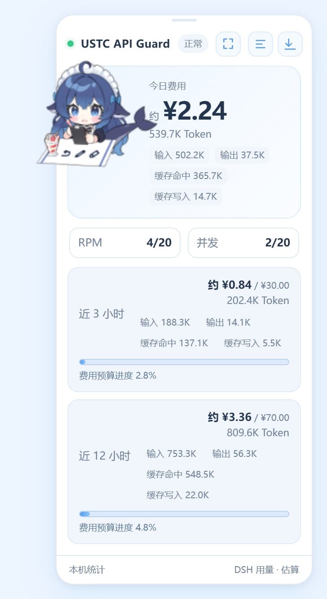
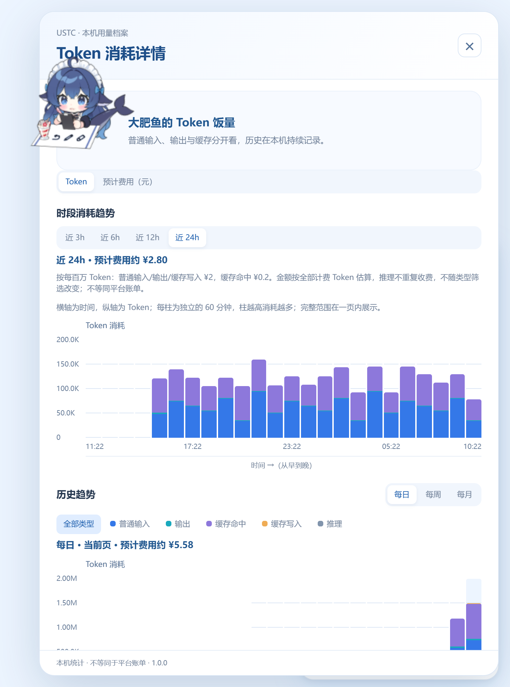
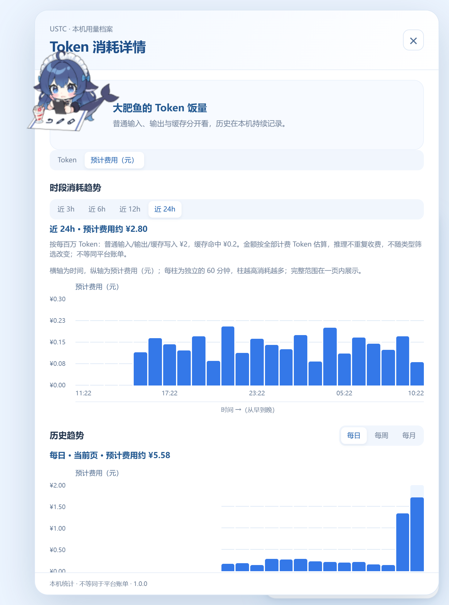

# USTC API Guard 1.0.0

在 DSH 中查看 USTC 模型的用量、预计费用和历史图表。

## 安装

1. 解压随项目提供的 `USTC一键安装包.zip`。
2. 保存工作，完全退出 DSH，包括托盘中的进程。
3. 双击 `install.cmd`，按提示选择 DSH 安装目录和当前用户的 profile 路径。
4. 安装成功后重新启动 DSH。

## 使用

- 选择 USTC 模型后，在面板查看今日、近 3 小时和近 12 小时用量。
- 点击详情按钮，查看 Token 或预计费用图表；可以切换时间范围、筛选类型、点击柱子查看明细。
- 点击最小化按钮收起面板，点击浮条恢复；拖动顶部横条移动，双击复位。
- 费用为本机估算，不等同平台账单。

## 界面预览

以下图片由当前插件界面渲染，使用示例数据。

### 主面板

### 最小化

### Token 图表

### 费用图表

## 许可

原创代码采用 MIT。鲸鱼娘模型和美术采用 [CC BY-NC-SA 4.0](https://creativecommons.org/licenses/by-nc-sa/4.0/)，作者为上善无形、ZipZipPipe、氵六青，模型未修改；其他素材及运行库的许可文件随插件保留。
